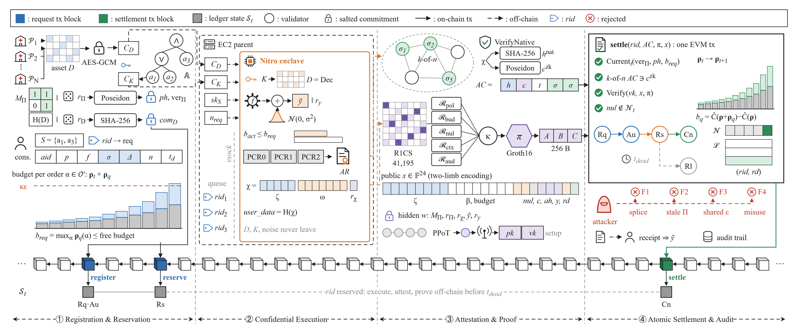

# TrustCircuit

TrustCircuit binds every step of a privacy-preserving data-use request to one request identity and settles it atomically on an EVM chain. A request is registered against salted policy and dataset commitments, reserves its Rényi-DP budget on-chain, runs inside a TEE, is attested by a *k*-of-*n* validator quorum, and is proven with a Groth16 compliance proof. One `settle` transaction then checks the current policy version, the quorum statement, the proof, and nullifier freshness, consumes the budget, and appends the audit record.



## Components

| Path | Contents |
|---|---|
| `contracts/` | `DataRegistry`, `AccessController`, `BudgetLedger` (on-chain RDP vector), `ValidatorRegistry` (*k*-of-*n* quorum), `AuditLedger`, `ComplianceVerifier`, `SettlementCore`, `TrustCircuitSettlement`, `TimelockMultisig`, Groth16 verifier; `SignAndHashSettlement` and `StageWiseSettlement` are comparison designs |
| `zk/` | VCP v3 circuit (`circuits/vcp_v3.circom`, 24 public signals), setup ceremony script and transcript, proof benchmark |
| `scripts/` | Shared stack and encoding helpers (`lib/`), attack matrix and gas benchmarks (`experiments/`) |
| `dp/` | Gaussian-mechanism utility experiment on a seeded synthetic cohort |
| `crypto/` | CP-ABE (Rust `rabe`, AC17/FAME) and AES-GCM hybrid-encryption benchmarks |
| `tee/nitro/` | AWS Nitro Enclaves worker, attestation and pool benchmarks |
| `analysis/` | Multi-party network model (prover capacity, budget contention, quorum risk) |
| `benchmarks/` | Base Sepolia campaign and plotting scripts |
| `results/` | Canonical measurements: `raw/`, `summary/`, `figures/` |

## Setup

Requires Node.js 22, Python 3.12, Circom 2.2.2 (binary in `tools/`), and Rust for the CP-ABE benchmark.

```bash
npm ci
python -m venv .venv && .venv/Scripts/pip install -r requirements.txt
npm run compile
npm test
```

## Proof system

The proving key comes from a two-phase ceremony. Phase 1 is the PSE Perpetual Powers of Tau (round 80, 2^16), downloaded to `zk/ptau/ppot_0080_16.ptau`; phase 2 is recorded in `zk/ceremony/vcp_v3_transcript.json`, and any party can append a contribution.

```bash
node zk/scripts/ceremony_v3.js build                     # compile the circuit
node zk/scripts/ceremony_v3.js init
node zk/scripts/ceremony_v3.js contribute --name "Name"
node zk/scripts/ceremony_v3.js beacon --hash <hex> --source "<origin of the hash>"
node zk/scripts/ceremony_v3.js finalize                  # verification key and Solidity verifier
```

## Experiments

| Command | Measures | Output |
|---|---|---|
| `npm run bench:vcp` | Proving time, verifier gas, 24 public-signal mutations | `vcp_v3_runs.csv`, `vcp_v3_summary.json` |
| `npm run bench:attacks` | Splice, stale policy, shared budget, forbidden use, replay against three designs | `attack_matrix.{csv,json}` |
| `npm run bench:gas` | Settlement ablation, quorum sweep, RDP order-set cost, on-chain RDP trace | `settlement_gas.csv`, `rdp_trace.csv`, `gas_benchmarks.json` |
| `npm run bench:network` | Pipeline capacity, Erlang-C prover pool, budget contention | `network_*.csv`, `network_model.json` |
| `npm run bench:dp` | DP error vs. ε on 50,000 synthetic records | `dp_utility*.csv` |
| `npm run bench:cpabe` | CP-ABE cost vs. policy size | `cpabe_policy_*.csv` |
| `npm run bench:hybrid` / `bench:aes` | Hybrid encryption and AES-GCM throughput and memory | `abe_payload_*.csv`, `aes_gcm_scaling_v2*.csv` |
| `npm run plot` | All figures from the stored results | `results/figures/` |

Nitro measurements run on an EC2 host with Nitro Enclaves enabled; see the scripts in `tee/nitro/`.

### Public testnet

The Base Sepolia campaign deploys the full stack with separate deployer, governance, operator, provider, consumer, and validator keys. Put a funded key in `.env`:

```bash
TRUSTCIRCUIT_TESTNET_PRIVATE_KEY=0x...
BASE_SEPOLIA_RPC_URL=https://base-sepolia-rpc.publicnode.com   # optional
```

```bash
npm run testnet:smoke     # one request lifecycle
npm run testnet           # 30 lifecycles
```

Per-run role keys are written to `secrets/` (git-ignored); `node benchmarks/base_sepolia_v3.js --sweep secrets/<run>.json` returns leftover test ETH.

## Scope

The circuit proves policy admissibility, budget bounds, nullifier, context, and audit consistency for one request. Native attestation certificate chains are verified by the validators off-chain, and the correctness of the TEE program and of its noise sampling rests on the TEE trust assumption.

## License

MIT
